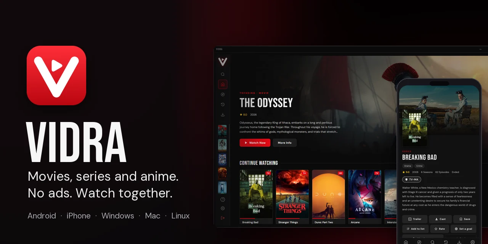

<p align="center">
  
</p>

<p align="center">
  <a href="https://github.com/SoloHandCoder/vidra-android/releases/latest"></a>
  <a href="https://github.com/SoloHandCoder/vidra-android/releases"></a>
  
  <a href="LICENSE"></a>
</p>

<p align="center">
  <a href="https://github.com/SoloHandCoder/vidra-android/releases/latest"></a>
</p>

<p align="center">
  Also on <a href="https://github.com/SoloHandCoder/vidra-desktop"><b>Windows, Mac &amp; Linux</b></a> and <a href="https://github.com/SoloHandCoder/vidra-ios"><b>iPhone &amp; iPad</b></a>. Your library syncs between all of them.
</p>

<p align="center">
  
</p>

## ✨ What you get

<table>
<tr>
<td width="50%" valign="top">

**🎬 Everything in one place**<br>
Movies, series and anime with posters, trailers, cast and ratings. "Because you watched…" rows and a Discover page with collections, genres and filters.

**👥 Watch parties**<br>
Play, pause and skipping stay in sync with friends on other phones and computers. Chat, emoji reactions, a host, a ready check with a 3‑2‑1 countdown, a shared queue and polls. End‑to‑end encrypted.

**⏭️ Up next**<br>
When the credits roll, the next episode starts after a short countdown, and the one you finished is marked as watched.

**📥 Downloads**<br>
Save movies or whole seasons as MP4 and watch offline. Smart downloads fetch the next episodes for you, with a Wi‑Fi‑only option.

</td>
<td width="50%" valign="top">

**☁️ Sync and profiles**<br>
Watchlist, progress, ratings and lists sync with your other devices. Everyone in the house gets a profile, kids profiles have an age limit and a PIN.

**🎨 Make it yours**<br>
Eleven themes from AMOLED black to Sepia, an Auto mode that follows your phone, any accent colour, and six app languages.

**🔔 Never miss an episode**<br>
Reminders when new episodes come out, following actors and directors, watch‑time goals and a yearly recap card to share.

**📺 Big screen ready**<br>
Chromecast, picture‑in‑picture, lock‑screen controls and Android TV with remote navigation. Ads and trackers are blocked.

</td>
</tr>
</table>

## 🎉 Watch together

<table>
<tr>
<td width="38%" align="center"></td>
<td valign="middle">

1. Open a movie or show and tap **Watch party → Start a party**.
2. Tap **Invite** and send the link, or just the code.
3. Watch in sync. Messages pop up over the video, so you don't need the chat open.

**The host** decides who controls playback, runs a **ready check** so everyone starts together, keeps the **queue** of what's next and can start a **poll** about it.

</td>
</tr>
</table>

## 🎨 Themes

<p align="center">
  
</p>

## 📲 Install

1. Download the latest `Vidra-Android-*.apk` from **[Releases](https://github.com/SoloHandCoder/vidra-android/releases/latest)** and open it. Android asks once to allow installing apps from your browser or file manager.
2. On first start, paste your free **TMDB read access token** ([how to get one](https://github.com/SoloHandCoder/vidra-desktop/blob/main/tmdb-tutorial.md)). It's used to load titles, posters and info.
3. Updates are built in: Settings → **Check for updates**, or automatically on start.

> [!NOTE]
> Vidra was called **Streambert Android** until 2.23. It installs over the old app as an update and keeps all your data.

## ❓ FAQ

<details>
<summary><b>Is it free? Are there ads?</b></summary>

Free and open source. There are no ads in the app, and ad and tracker requests from the video sources are blocked as well as possible.
</details>

<details>
<summary><b>Do my friends need Vidra for a watch party?</b></summary>

Yes, on any platform (Android, iPhone, Windows). Everyone should pick the same source. Messages go through a public relay but are end‑to‑end encrypted with the party code, so the relay only sees scrambled data.
</details>

<details>
<summary><b>How does sync work?</b></summary>

Settings → Profiles &amp; Privacy → Cloud sync. Your data goes into a private GitHub Gist under your own account (the token only needs the <code>gist</code> permission). There's no Vidra server.
</details>

<details>
<summary><b>Where are my downloads?</b></summary>

Settings → Downloads lets you choose: app storage (default), the public <code>Movies/Streambert</code> folder (shows up in your gallery and VLC), or any folder including SD cards.
</details>

## 🛠️ For developers

<details>
<summary><b>How it works</b></summary>

- **UI**: the desktop React app (`src/`) almost unchanged, plus `src/styles/mobile.css` (bottom nav in portrait, side rail in landscape, touch sizing).
- **`window.electron` shim** (`src/mobile/electronShim.js`): implements the desktop preload API on Android, so the pages run as-is.
- **`<webview>` → `MobileWebView`** (`src/mobile/MobileWebView.jsx`): iframe with `executeJavaScript` / load events, backed by a bridge injected into every frame (`android/app/src/main/assets/sb-inject.js`).
- **Native layer** (`android/app/src/main/java/com/streambert/android/`):
  - `SbWebViewClient`: ad/tracker blocking, m3u8/vtt capture, stops embedded players from hijacking the app.
  - `SbChromeClient`: popup blocking, native fullscreen with auto-landscape.
  - `StreamProxy`: in-WebView media proxy that adds the Referer.
  - `Downloads` + `DownloadService`: native HLS downloader (6 parallel connections, keys/init segments, foreground service, pause/resume, auto-resume, Wi‑Fi only).
  - `Remuxer`: turns finished HLS downloads into one MP4 with MediaExtractor/MediaMuxer (no ffmpeg); AES-128 supported.
  - `StorageMover` + `ContentServe`: app storage, public Movies folder or any picked folder, served to the player with range support.
  - `MediaControl` + `MediaPlaybackService`: lock-screen, notification and headset controls.
  - `CastPlugin` + `LanServer`: Chromecast for streams and downloads.
- **Watch party** (`src/mobile/party.js`): MQTT over WebSocket with fallback brokers; AES-GCM key and topic derived from the party code.
</details>

<details>
<summary><b>Build</b></summary>

Requirements: Node 22+, JDK 21, Android SDK (platform 35).

```bash
npm install
npm run build
npx cap sync android
cd android
gradlew.bat assembleRelease
```
Output: `android/app/build/outputs/apk/release/app-release.apk`. Release signing reads `android/keystore.properties` (not committed); without it, use `assembleDebug`.
</details>

<details>
<summary><b>Releasing</b></summary>

```bash
node scripts/release.mjs 2.25.0 --notes-file notes.md
```
Bumps the version, builds the signed APK into `release/`, commits, tags `v<version>-android`, pushes, and creates the GitHub release. The app's update check reads this repo's releases, so the repo has to stay public.
</details>

<details>
<summary><b>Cloud sync format</b></summary>

A secret Gist named **"Streambert sync"** (the name is kept so older versions keep syncing):
- `streambert-sync.json`: `{ app, version, updatedAt, profiles: [{id, name, color}], deleted: [ids] }`
- `profile-<id>.json`: `{ version, updatedAt, profile, data: { saved, savedOrder, history, progress, watched, … } }`

Merging is three-way (`src/mobile/syncMerge.js`): per entry for maps, per watched item for history (newest `watchedAt` wins), deletions carry over.
</details>

## 💛 Credits

Vidra is based on **[Streambert](https://github.com/truelockmc/streambert)** by truelockmc. All credit for the original app goes to them. Movie and show data comes from [TMDB](https://www.themoviedb.org/); Vidra isn't endorsed or certified by TMDB.

## ⚖️ Legal

Vidra is for personal and educational use. It doesn't host, store or distribute any content: it shows information from TMDB and plays what third-party websites provide. You are responsible for making sure you're allowed to watch what you open. Please support creators through legal services.

Licensed under the [GPL-3.0](LICENSE). Forks must stay open source.
